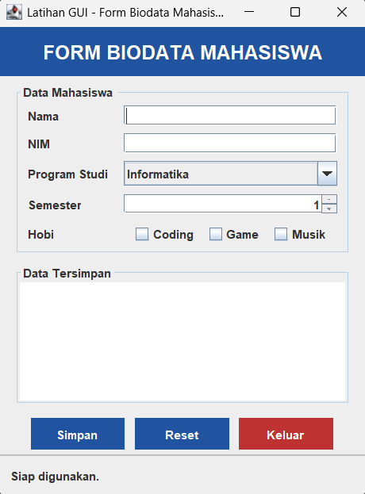
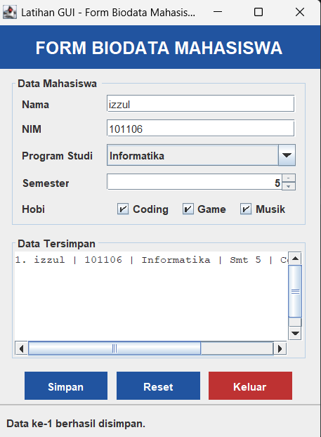
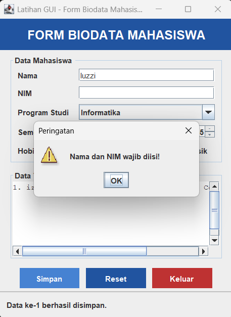
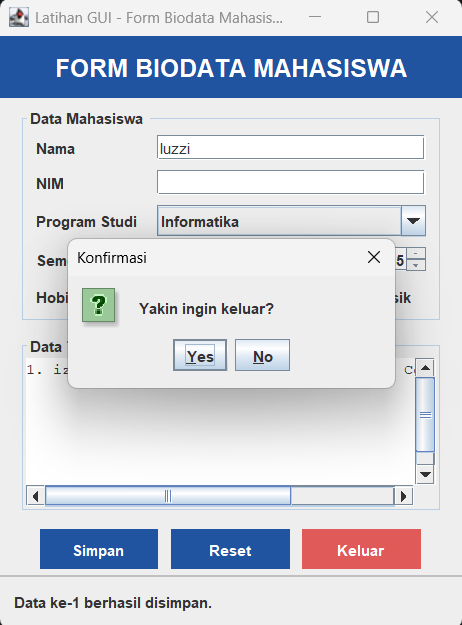

# Latihan GUI Java Swing - Form Biodata Mahasiswa

Eksplorasi GUI menggunakan **Java Swing**: sebuah form biodata mahasiswa yang bisa menyimpan data ke daftar, mereset form, dan keluar dengan konfirmasi.

## Fitur

- Input **Nama** dan **NIM** (NIM hanya menerima angka, maksimal 12 digit)
- Pilih **Program Studi** (combo box), **Semester** (spinner), dan **Hobi** (checkbox)
- Tombol **Simpan** menambahkan data ke area "Data Tersimpan" (dengan validasi jika Nama/NIM kosong)
- Tombol **Reset** mengosongkan form, tombol **Keluar** meminta konfirmasi
- Efek *hover* pada tombol dan *status bar* di bagian bawah

## Struktur Repositori

```
.
├── LatihanGUI.java          # kode program
├── README.md                # dokumentasi
└── screenshots/
    ├── tampilan-awal.png
    ├── setelah-simpan.png
    ├── validasi-nim-kosong.png
    └── konfirmasi-keluar.png
```

## Cara Menjalankan

Pastikan JDK 8 atau lebih baru sudah terpasang.

```bash
javac LatihanGUI.java
java LatihanGUI
```

## 5 Komponen Utama GUI yang Digunakan

### 1. Top-level Container: `JFrame`

Jendela utama aplikasi. Class `LatihanGUI` meng-extend `JFrame`, sehingga menjadi wadah paling luar yang menampung semua komponen lain.

### 2. Intermediate Container: `JPanel` dan `JScrollPane`

Wadah perantara di dalam frame untuk mengelompokkan komponen:

| Container | Fungsi |
|-----------|--------|
| `JPanel` header | Judul berlatar biru |
| `JPanel` form | Kumpulan input data mahasiswa |
| `JPanel` hobi | Tiga checkbox hobi dalam satu baris |
| `JScrollPane` | Pembungkus `JTextArea` agar bisa di-scroll |
| `JPanel` tombol | Tombol Simpan, Reset, Keluar |
| `JPanel` footer | Gabungan panel tombol dan status bar |

### 3. Atomic Component

Komponen paling kecil yang berinteraksi langsung dengan user:

| Class | Dipakai untuk |
|-------|---------------|
| `JLabel` | Judul, label field, status bar |
| `JTextField` | Input Nama dan NIM |
| `JComboBox` | Pilihan Program Studi |
| `JSpinner` | Pilihan Semester (1-14) |
| `JCheckBox` | Pilihan Hobi |
| `JTextArea` | Menampilkan data tersimpan (read-only) |
| `JButton` | Simpan, Reset, Keluar |

### 4. Layout Classes (4 layout)

| Class | Dipakai di | Alasan |
|-------|-----------|--------|
| `BorderLayout` | Frame utama dan panel isi | Membagi area atas (header), tengah (isi), bawah (footer) |
| `GridBagLayout` | Panel form | Label dan input tersusun rapi dalam kolom, input melebar mengikuti jendela |
| `FlowLayout` | Header, panel hobi, panel tombol | Komponen berjajar sejajar dalam satu baris |
| `GridLayout` | Footer | Membagi dua baris sama besar: tombol dan status bar |

### 5. Event Listener

Interface (semua method wajib di-override):

| Interface | Method yang di-override | Fungsi |
|-----------|------------------------|--------|
| `ActionListener` | `actionPerformed()` | Aksi klik tombol Simpan, Reset, Keluar |
| `ItemListener` | `itemStateChanged()` | Memperbarui status bar saat Program Studi diganti |

Adapter class (cukup override method yang dibutuhkan saja):

| Adapter | Method yang di-override | Fungsi |
|---------|------------------------|--------|
| `KeyAdapter` | `keyTyped()` | Membatasi NIM hanya angka dan maksimal 12 digit |
| `MouseAdapter` | `mouseEntered()`, `mouseExited()` | Mengubah warna tombol saat kursor masuk/keluar |
| `WindowAdapter` | `windowClosing()` | Menampilkan konfirmasi saat tombol X ditekan |

## Hierarki Komponen

```
JFrame (LatihanGUI)                        [BorderLayout]
├── NORTH  : JPanel header                 [FlowLayout]
│            └── JLabel judul
├── CENTER : JPanel isi                    [BorderLayout]
│   ├── NORTH  : JPanel form               [GridBagLayout]
│   │            ├── JLabel + JTextField (Nama, NIM)
│   │            ├── JLabel + JComboBox (Program Studi)
│   │            ├── JLabel + JSpinner (Semester)
│   │            └── JLabel + JPanel hobi  [FlowLayout] -> 3 JCheckBox
│   └── CENTER : JScrollPane -> JTextArea
└── SOUTH  : JPanel footer                 [GridLayout 2x1]
             ├── JPanel tombol             [FlowLayout] -> 3 JButton
             └── JLabel status
```

## Screenshot

**Tampilan awal**



**Setelah klik Simpan**



**Validasi saat Nama/NIM kosong**



**Konfirmasi keluar**


